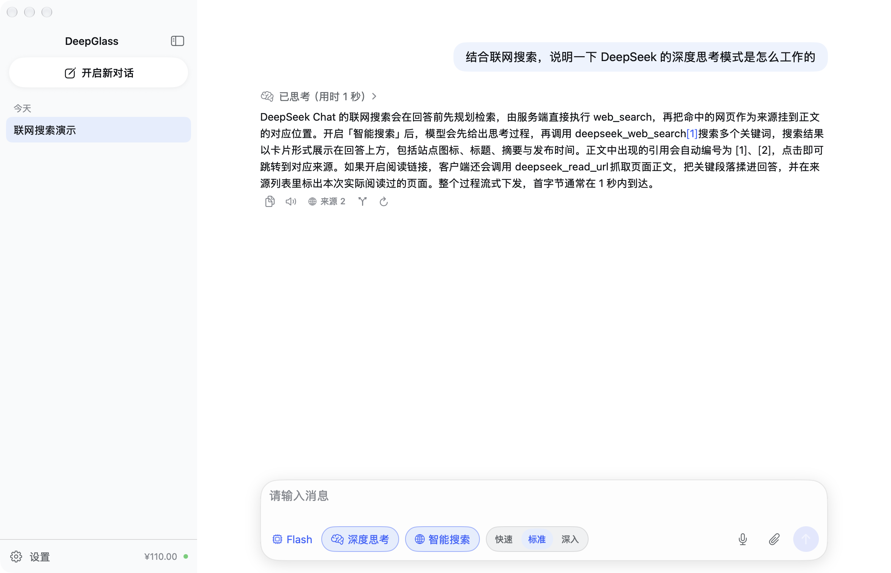
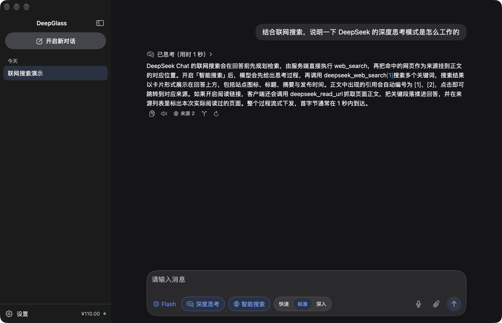
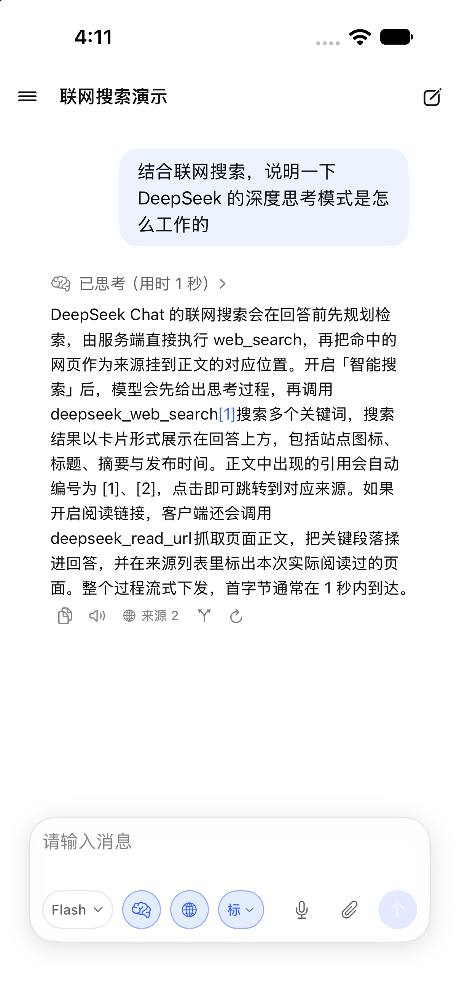
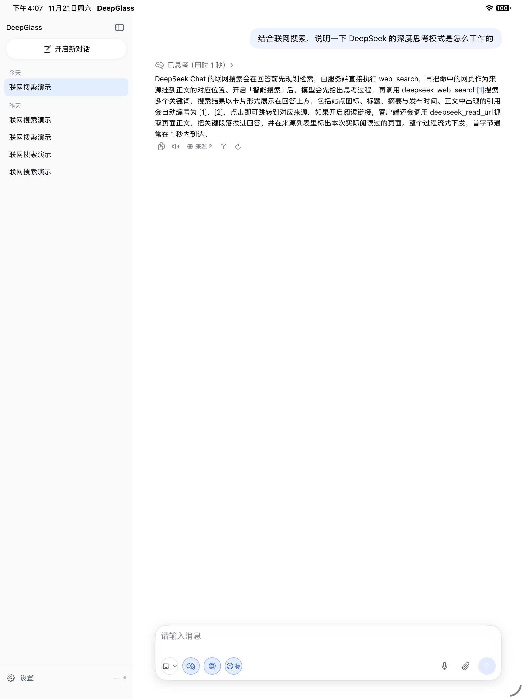
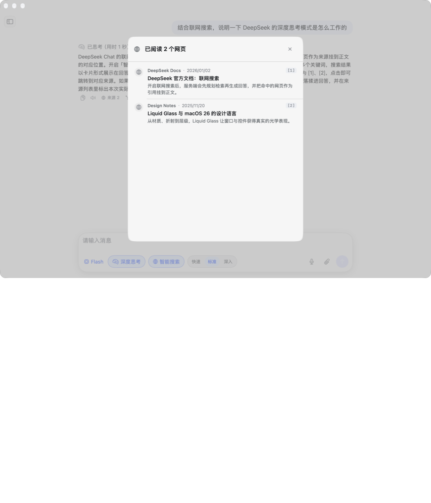
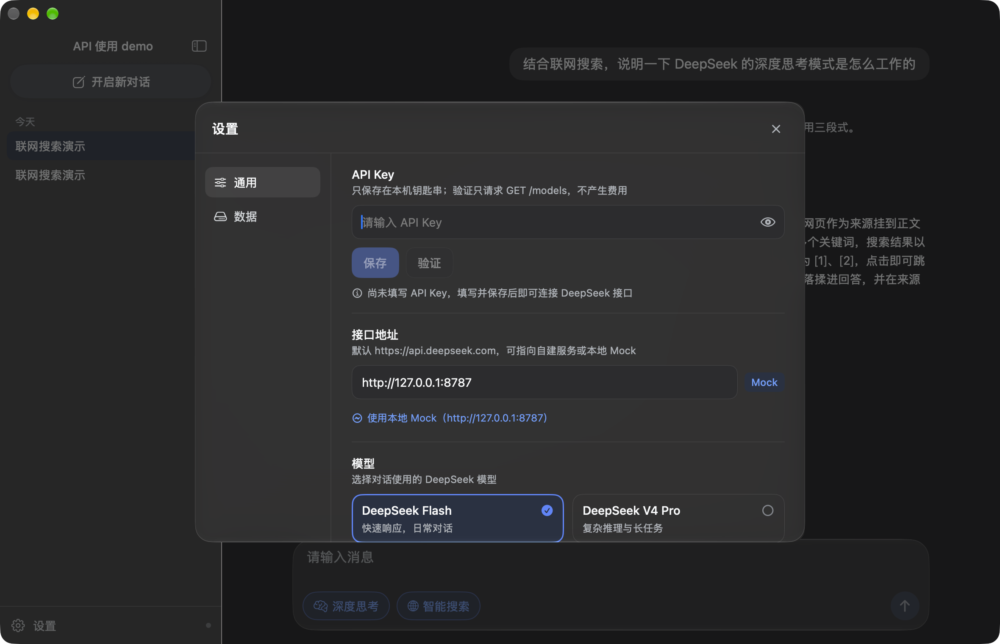
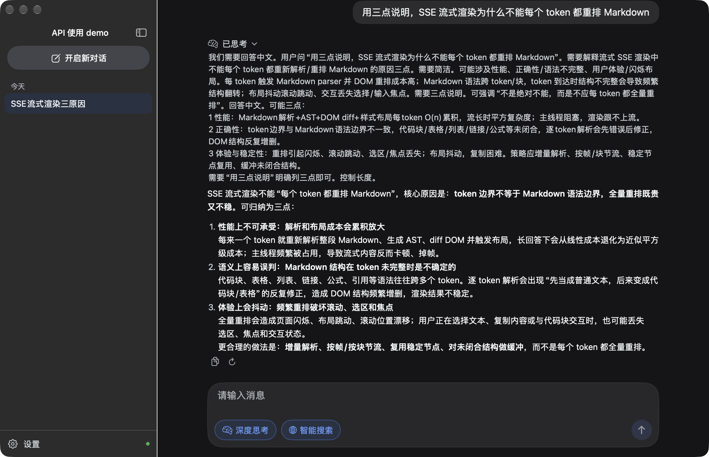

# DeepGlass

用 **SwiftUI + Liquid Glass** 复刻的 DeepSeek Chat 客户端，一套源码运行在 **macOS / iPadOS / iOS**。

视觉与交互基准是官方开源示例 [deepseek-ai/chat-demo](https://github.com/deepseek-ai/chat-demo)（MIT）。
方案与决策记录见 [PLAN.md](PLAN.md)，与原版的差异审计见 [docs/DEVIATIONS.md](docs/DEVIATIONS.md)。

| macOS（浅色） | macOS（深色） |
|---|---|
|  |  |

| iPhone | iPad |
|---|---|
|  |  |





---

## 已实现（P0）

**对话**
- 真实 DeepSeek API 直连（Anthropic 兼容 `POST /anthropic/v1/messages`，SSE 流式）
- 停止生成 / 继续生成 / 重新生成；发送即插入乐观占位
- 思考过程时间线：可折叠、思考中/已停止/有正文三态标题、搜索与读链接步骤、来源标题
- 自动标题（读服务端 `message_delta.title`，失败时按首句兜底）

**渲染**
- 自研 Markdown 渲染器：标题、段落、粗斜体/删除线、行内代码、链接、图片、有序/无序/任务列表、引用、表格、分割线
- 代码块：语言标签、复制、横向滚动、轻量语法着色（swift/ts/js/python/json/bash/html/css/sql…）
- 公式（`$…$` / `$$…$$`）与 Mermaid：本地 KaTeX / mermaid 的 WKWebView 岛，失败降级为等宽源码

**外壳（Liquid Glass）**
- macOS 使用原生侧栏材质（`NSVisualEffectView(.sidebar)`）+ 透明窗口，玻璃可采样后方内容
- 输入框、设置弹窗、浮动按钮使用原生 `glassEffect`
- 减弱透明度时降级 `.ultraThinMaterial`，减弱动效时禁用 morph

**其它**
- 会话：新建（惰性创建，点「开启新对话」不会产生空会话）/ 重命名 / 删除 / 置顶 / 按「今天·昨天·7 天内·30 天内·按月」分组
- 消息版本：重新生成产生新版本，可 `‹ 2/3 ›` 切换；编辑用户消息后从该点分叉
- 双语：简体中文 / English，设置里实时切换
- 附件：选择文件上传到 Files API（图片走 image 块、文档走 document 块），支持失败重试与移除
- 语音：输入框内听写（Speech framework）、消息朗读（AVSpeechSynthesizer）
- 账户余额：侧栏底部显示余额（`GET /user/balance`），可在设置里关闭
- 滚动：流式生成时只在贴近底部才跟随，向上滑动立即让出滚动条，右下角提供「回到最新」
- 设置：API Key（Keychain + `GET /models` 校验三态）、接口地址（可切本地 Mock）、模型选择、深度思考 / 智能搜索开关、主题三态
- 持久化：自动保存会话与草稿；API Key 只进 Keychain
- 三端适配：macOS 隐藏标题栏 + 菜单命令；iPad 分栏；iPhone 抽屉 + 吸底输入框

## 构建成 App

### 方式一：Xcode 里点运行（推荐）

```bash
brew install xcodegen
./scripts/gen.sh
open DeepGlass.xcodeproj
```

选择 `DeepGlass-macOS` scheme → ⌘R。产物在
`~/Library/Developer/Xcode/DerivedData/DeepGlass-*/Build/Products/Debug/DeepGlass.app`，
可以直接拖进「应用程序」文件夹。

iOS：切到 `DeepGlass-iOS` scheme，选模拟器直接 ⌘R。

### 方式二：命令行出可分发的 .app / zip

```bash
./scripts/package.sh
```

产出：

```
dist/DeepGlass.app            可直接双击运行（ad-hoc 签名）
dist/DeepGlass-0.1.0.zip      发给别人的压缩包
```

拷到本机其他位置或别的 Mac 时，若被 Gatekeeper 拦下，右键 → 打开，
或 `xattr -dr com.apple.quarantine /Applications/DeepGlass.app`。

### 真机 / 对外分发（需要开发者账号）

**iOS 真机**：`project.yml` 里给 `DeepGlass-iOS` 加两行后重新 `./scripts/gen.sh`，
或在 Xcode 的 Signing & Capabilities 里选 Team：

```yaml
    settings:
      base:
        DEVELOPMENT_TEAM: ABCDE12345
        CODE_SIGNING_ALLOWED: YES
```

**macOS 对外分发**：需要用 Developer ID 证书签名并通过公证，否则别人打开会提示无法验证开发者。

```bash
codesign --force --deep --options runtime \
  --sign "Developer ID Application: 你的名字 (TEAMID)" dist/DeepGlass.app
xcrun notarytool submit dist/DeepGlass-0.1.0.zip \
  --apple-id you@example.com --team-id TEAMID --password 应用专用密码 --wait
xcrun stapler staple dist/DeepGlass.app
```

默认只构建 arm64。要出 Intel 也能跑的通用二进制：

```bash
xcodebuild -project DeepGlass.xcodeproj -scheme DeepGlass-macOS \
  -configuration Release -destination 'platform=macOS' \
  ARCHS="arm64 x86_64" ONLY_ACTIVE_ARCH=NO build
```

首次启动在「设置」填入 DeepSeek API Key，接口地址保持 `https://api.deepseek.com`。

### 没有 Key 也能跑

```bash
python3 scripts/mock-server.py       # 127.0.0.1:8787，输出带思考/搜索/引用的完整 SSE
```

设置里点「使用本地 Mock」，Key 随便填。或直接用演示参数启动：

```bash
DEEPSEEK_API_KEY=sk-xxx open -n build/dd/Build/Products/Debug/DeepGlass.app --args --demo
# 可选：--dark  --settings  --origin=http://127.0.0.1:8787  --prompt="..."
# QA：--qa-branch 连续两次重新生成，用于验证版本切换
```

数据隔离：`DEEPGLASS_STORE_DIR=/tmp/dgqa` 可让 QA 实例使用独立会话目录，
不会碰 `~/Library/Application Support/DeepGlass/`。

## 结构

```
App/
  DesignSystem/     令牌（取自原版 theme.css）、玻璃原语、原子组件、侧栏材质
  Features/
    Sider/          会话侧栏（分组、重命名、置顶、删除）
    Chat/           消息列表、思考时间线、消息行、欢迎页
    Composer/       输入框（玻璃、开关、发送/停止）
    Markdown/       解析器 + 原生渲染 + 公式/图表 Web 岛
    Settings/       设置面板（玻璃 sheet）
  Services/         会话存储、设置、Keychain、窗口配置、演示模式
Core/               DeepSeekKit：协议 / SSE / 累加器（92 个单元测试）
Reference/chat-demo 原版源码（只读对照）
scripts/            工程生成、构建、截图、mock 服务
```

## 测试

```bash
swift test --package-path Core
# Executed 107 tests, with 1 test skipped and 0 failures
```

## 对比与差异

- [docs/FIDELITY.md](docs/FIDELITY.md)：与原版 Web 的实测对照（261 / 840 / 776 / 14px 等逐项）
- [docs/DEVIATIONS.md](docs/DEVIATIONS.md)：有意的设计差异与已知不一致

## 已知未实现

引用角标内联跳转、拖拽入附件、历史导入导出（原版 zip 格式）。
详见 [PLAN.md](PLAN.md) 的 P1/P2 清单。
